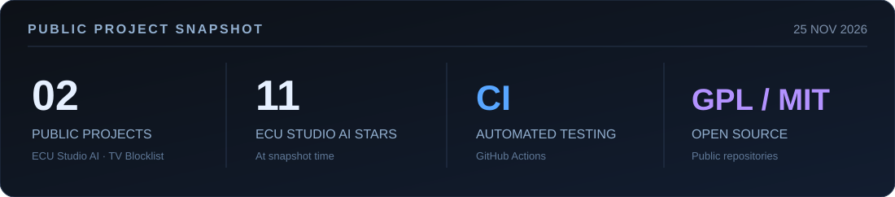

 

**Software developer** · **Open-source projects** · **Automotive &amp; developer tools**

I build practical software for complex technical problems, with a focus on binary analysis, desktop applications and reproducible testing.  
My main project is **ECU Studio AI**, a free and open-source ECU and TCU calibration workbench.

[**🚀 Featured: ECU Studio AI**](https://github.com/PCTestAdmin/ECU-Studio-AI) · [**⬇ Stable release**](https://github.com/PCTestAdmin/ECU-Studio-AI/releases/latest) · [**🧪 Pre-release**](https://github.com/PCTestAdmin/ECU-Studio-AI/releases/tag/v1.21.0-rc1) · [**📁 Repositories**](https://github.com/PCTestAdmin?tab=repositories)

---

## 🚀 Featured project · ECU Studio AI

**ECU Studio AI** is an open-source calibration workbench for engine and transmission control-unit files, built to make advanced firmware analysis more accessible, transparent and reproducible.

- 🔎 **Map discovery** — find potential calibration maps through code references, structural evidence and data patterns.
- 🗺️ **Explore & edit** — tables, axes, 2D/3D views, hexadecimal data and definition imports.
- 🔄 **Compare software versions** — inspect changes and review map-transfer suggestions.
- 🛡️ **Checksums & integrity** — inspect supported checksum structures, review corrections and keep original files unchanged.
- 🧪 **Evidence first** — experimental features and incomplete validation are clearly labelled.

[**CI & tests**](https://github.com/PCTestAdmin/ECU-Studio-AI/actions) · [**Project stars**](https://github.com/PCTestAdmin/ECU-Studio-AI/stargazers) · [**License**](https://github.com/PCTestAdmin/ECU-Studio-AI/blob/main/LICENSE) · [**Windows downloads**](https://github.com/PCTestAdmin/ECU-Studio-AI/releases/latest)

[**Explore the project →**](https://github.com/PCTestAdmin/ECU-Studio-AI) &nbsp; · &nbsp; [**Download latest release →**](https://github.com/PCTestAdmin/ECU-Studio-AI/releases/latest)

> **Engineering note:** Recognition evidence is not a guarantee of correctness. Checksum coverage is ECU-dependent, and the workbench does not certify a file as flash-ready.

### 🔬 Currently in development

| Release track | Status |
|:---|:---|
| [**v1.20.1**](https://github.com/PCTestAdmin/ECU-Studio-AI/releases/tag/v1.20.1) | Published stable release |
| [**v1.21.0-rc1**](https://github.com/PCTestAdmin/ECU-Studio-AI/releases/tag/v1.21.0-rc1) | Published release candidate |
| [**NextGen recognition**](https://github.com/PCTestAdmin/ECU-Studio-AI/pull/30) | Experimental development — not released |

Current development focuses on code-backed curve detection, shared-axis identity, safer editing and clearer uncertainty indicators. The next release is in preparation.

| Development benchmark | rc1 | Quality phase 5 |
|:---|---:|---:|
| Exact 2D map matches | 32,058 | **35,276** |
| Exact 1D matches | 102,973 | **125,837** |
| Map mix-ups | 5,316 | **4,117** |

Results on 58 development images, not independent validation. The experimental branch is not part of the stable release. QP5 reported 1,434 passing tests and 22 skipped tests.

[**Development report**](https://github.com/PCTestAdmin/ECU-Studio-AI/blob/103edbfa273fdd5082d4106f8b518859deb36236/docs/ENTWICKLUNG_NEXTGEN.md) · [**Roadmap**](https://github.com/PCTestAdmin/ECU-Studio-AI/blob/main/ROADMAP.md) · [**Feedback**](https://github.com/PCTestAdmin/ECU-Studio-AI/issues)

---

## 🛠️ Technologies & tools

## 📊 GitHub at a glance

Snapshot taken on 25 November 2026. For live activity, see the contribution graph and pinned projects below.

## 📁 More from my workbench

| Project | What it does |
|:---|:---|
| [**📺 TV Blocklist**](https://github.com/PCTestAdmin/tv-blocklist) | A focused DNS blocklist for smart TVs, aiming to reduce ads and tracking while keeping essential services working. |
| **What's next?** | More software projects, experiments and useful tools are on the way. |

---

### ✨ Build carefully. Test honestly. Keep improving.

Thanks for visiting — feel free to explore the projects, open an issue or contribute.

