 

**Software developer** · **Open-source projects** · **Automotive &amp; developer tools**

I enjoy turning complex problems into practical, well-tested software.  
Currently building **ECU Studio AI** and exploring new ideas for future projects.

---

## 🚀 Featured project · ECU Studio AI

**ECU Studio AI** is an open-source calibration workbench for engine and transmission control-unit files, built to make advanced firmware analysis more accessible, transparent and reproducible.

- 🔎 **Map discovery** — find potential calibration maps through code references, structural evidence and data patterns.
- 🗺️ **Explore & edit** — tables, axes, 2D/3D views, hexadecimal data and definition imports.
- 🔄 **Compare software versions** — inspect changes and review map-transfer suggestions.
- 🛡️ **Checksums & integrity** — inspect supported checksum structures, review corrections and keep original files unchanged.
- 🧪 **Evidence first** — experimental features and incomplete validation are clearly labelled.

[**Explore the project →**](https://github.com/PCTestAdmin/ECU-Studio-AI) &nbsp; · &nbsp; [**Download latest release →**](https://github.com/PCTestAdmin/ECU-Studio-AI/releases/latest)

> **Engineering note:** Recognition evidence is not a guarantee of correctness. Checksum coverage is ECU-dependent, and the workbench does not certify a file as flash-ready.

---

## 🛠️ Technologies & tools

## 📊 GitHub at a glance

Live cards show publicly available GitHub data; statistics and language percentages are not measures of proficiency.

## 📁 More from my workbench

| Project | What it does |
|:---|:---|
| [**📺 TV Blocklist**](https://github.com/PCTestAdmin/tv-blocklist) | A focused DNS blocklist for smart TVs, aiming to reduce ads and tracking while keeping essential services working. |
| **What's next?** | More software projects, experiments and useful tools are on the way. |

---

### ✨ Build carefully. Test honestly. Keep improving.

Thanks for visiting — feel free to explore the projects, open an issue or contribute.

